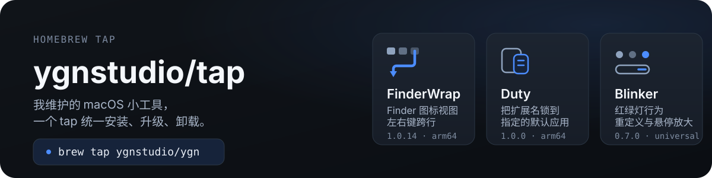

<p align="center">
  
</p>

这是我的个人 Homebrew tap，收纳自己维护的 macOS 小工具：Finder 图标视图的左右键跨行、文件扩展名的默认应用锁定、窗口红绿灯的行为重定义。加一次 tap，安装、升级、卸载都交给 Homebrew。

## 快速开始

```zsh
brew tap ygnstudio/ygn
brew install --cask ygnstudio/ygn/finderwrap
```

首次使用第三方 tap 时 Homebrew 会提示确认，请先核对仓库与 cask 内容。之后用 `brew update` + `brew upgrade --cask <名称>` 升级，`brew uninstall --cask <名称>` 卸载。

## 软件清单

| 应用 | 做什么 | 系统要求 | 安装 |
|---|---|---|---|
| [FinderWrap](https://github.com/ygnstudio/FinderWrap) | Finder 图标视图左右键跨行、Shift 跨行扩选、画廊与列表端点行为 | macOS 13+ · Apple Silicon | `brew install --cask ygnstudio/ygn/finderwrap` |
| [Duty](https://github.com/ygnstudio/Duty) | 把文件扩展名锁定到指定默认应用，被抢占后自动恢复 | macOS 14+ · Apple Silicon | `brew install --cask ygnstudio/ygn/duty` |
| [Blinker](https://github.com/ygnstudio/Blinker) | 红绿灯行为重定义与悬停放大 | macOS 15+ · Universal | `brew install --cask ygnstudio/ygn/blinker` |

## FinderWrap

给 Finder 图标视图补上左右键的跨行导航：行末按右键进入下一行首项，行首按左键返回上一行末项，文档首尾也会循环；按住 Shift 可把多选范围扩到相邻行。列表左右切项、画廊到头循环各有独立开关，面板「视图」区可单独关闭。

```zsh
brew install --cask ygnstudio/ygn/finderwrap
brew upgrade --cask ygnstudio/ygn/finderwrap
brew uninstall --cask ygnstudio/ygn/finderwrap
```

- 只驻留菜单栏，无 Dock 图标与主窗口；面板可隐藏菜单栏图标，此时应用继续在后台运行，重新打开 FinderWrap 会以小窗口显示面板。
- 需要授权**辅助功能**与**输入监控**，再开启「左右键自动换行」；不再需要「自动化 Finder」。
- 使用固定自签证书、未做 Apple 公证：首次打开被拦截时，核对来源后到「系统设置 → 隐私与安全性」允许打开。Homebrew 保留系统安全检查。
- 更新由源码仓 CI 产出固定签名包后手动更新 cask，不在安装时重新编译或签名；已手动安装过时，请先退出并备份原应用，不要直接 `--force` 覆盖。
- Intel 用户请继续使用 1.0.3；macOS 15 / 27 尚未实机验收，出现“无反应”时点菜单栏图标 →「复制诊断信息」回传（不含文件名与路径）。

## Duty

macOS 菜单栏小工具：把文件扩展名「锁定」到指定的默认应用，被其他应用抢占时自动恢复，并记录变更历史。2026-08 由 DutiUI 更名而来，旧 cask `dutiui` 已停用——请先 `brew uninstall --cask dutiui` 再安装 `duty`。

```zsh
brew install --cask ygnstudio/ygn/duty
brew upgrade --cask ygnstudio/ygn/duty
brew uninstall --cask ygnstudio/ygn/duty
```

- 需要 macOS 14+，仅 Apple Silicon；未公证，首次打开被拦截时执行 `xattr -cr /Applications/Duty.app`。

## Blinker

macOS 菜单栏小工具：红绿灯行为重定义与悬停放大。源码仓推送稳定版标签后由远端 Release 工作流测试、构建、校验并发布 DMG；本仓库的 **Update Blinker cask** 工作流会在每小时第 7、22、37、52 分钟检查最新稳定版，下载实际 DMG 与 `SHA256SUMS.txt` 核对后自动提交 cask 更新。

```zsh
brew install --cask ygnstudio/ygn/blinker
brew upgrade --cask ygnstudio/ygn/blinker
brew uninstall --cask ygnstudio/ygn/blinker
```

- 需要 macOS 15+，Universal（Apple Silicon 与 Intel）。
- 使用 ad-hoc 签名、未公证：首次打开被拦截时，核对下载来源，再按 [Apple 的说明](https://support.apple.com/102445) 到「系统设置 → 隐私与安全性」允许打开。安装流程不移除 quarantine，也不关闭 Gatekeeper。
- 启动后需在「系统设置 → 隐私与安全性 → 辅助功能」中授权；具体功能与权限以安装版本的说明为准。

<details>
<summary>目录结构</summary>

```
homebrew-ygn/
├── assets/readme/          # README 用的 SVG 资源
├── Formula/                # 当前为空
├── Casks/
│   ├── blinker.rb          # Blinker（自动更新 cask）
│   ├── duty.rb             # Duty（DMG 直链 GitHub Releases）
│   └── finderwrap.rb       # FinderWrap（固定签名包、手工更新）
├── Scripts/                # Blinker 稳定版更新与校验
└── .github/workflows/      # 校验、定时更新与手动更新入口
```
</details>

<details>
<summary>维护说明</summary>

- **Blinker**：自动更新。向源码仓推送稳定版标签后，等「Update Blinker cask」运行；也可在 Actions 手动运行同一工作流，`tag` 留空检查最新稳定版，或填写已发布的稳定版标签。相同或更旧版本会直接跳过，指定标签不能绕过校验或降级保护。本地预览：

  ```sh
  python3 Scripts/test-update-blinker.py
  python3 Scripts/update-blinker.py --latest            # 只看差异
  python3 Scripts/update-blinker.py --latest --write    # 写入后自行提交
  ruby -c Casks/blinker.rb
  ```

  GitHub 调度可能延迟；公开仓库连续 60 天无活动时定时任务会被停用，需要时到 Actions 重新启用。

- **FinderWrap**：手工更新。从源码仓 CI 取固定签名的 DMG、ZIP、校验文件与签名清单，验签后发布到其 `v<版本>` Release，再更新 `Casks/finderwrap.rb` 的 `version`（含构建号）、`sha256` 与 `depends_on`；签名私钥在 Actions Secrets，证书变更须作为明确迁移处理，不能自动更换。

- 修改任何 cask 后跑一遍 `brew style Casks/*.rb` 与 `brew audit --cask <名称>`，再提交。
</details>

## License

详见 [LICENSE](LICENSE)。各软件本身的许可证以其源码仓库为准；本仓库只存放 cask 与文档。
