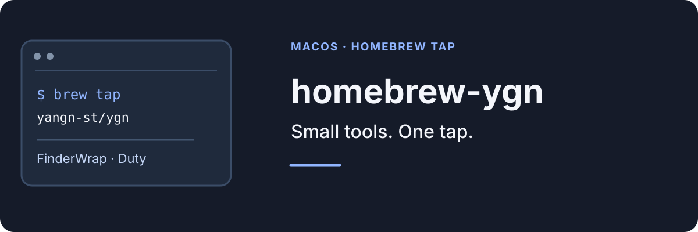

**English | [简体中文](README.zh-CN.md)**

<p align="center">
  
</p>

A personal Homebrew tap for macOS utilities maintained by YanGN.

A tap lets Homebrew track versions, checksums and system requirements for apps that are not in the main cask repository. Each cask downloads the exact artifact published by its project; the tap does not rebuild or re-sign it.

## Casks

| App | Purpose | Requirements |
|---|---|---|
| [FinderWrap](https://github.com/YanGN-ST/FinderWrap) | Row-wrapping arrow-key navigation in Finder icon views | macOS 13+, Apple Silicon |
| [Duty](https://github.com/YanGN-ST/Duty) | Monitor and restore selected default file associations | macOS 14+, Apple Silicon |

## Install

```sh
brew tap yangn-st/ygn
brew install --cask yangn-st/ygn/finderwrap
```

Review the tap and its casks before confirming Homebrew's prompt. Upgrade an app with `brew upgrade --cask <name>` and remove it with `brew uninstall --cask <name>`.

## FinderWrap

FinderWrap makes Left and Right wrap across rows in Finder icon view and extends Shift selection into adjacent rows. Gallery cycling and list-view navigation have their own switches in the menu-bar panel.

- Requires Accessibility and Input Monitoring permissions before left/right wrapping can be enabled.
- The build uses a fixed self-signed certificate and is not notarized. If macOS blocks the first launch, verify the download source and allow it in **System Settings → Privacy & Security**.
- Apple Silicon only, macOS 13 or later. macOS 15 and 27 still need hardware verification.
- If the app appears unresponsive, use **Copy diagnostics** in the menu-bar panel; the report excludes file names, paths and typed keys.

## Duty

Duty locks file associations to the apps you choose and restores them when another app takes them over. It also records association changes when history is enabled.

- Requires macOS 14 or later and Apple Silicon.
- The app is not notarized. If Gatekeeper blocks the first launch, verify the source and follow the system prompt, or run `xattr -cr /Applications/Duty.app`.
- The optional `duti` component helps identify uncommon extensions that the system cannot resolve; Duty works without it.

## Maintenance

<details>
<summary>Updating casks</summary>

Cask files live in `Casks/`. FinderWrap releases are packaged with a fixed signing identity and require a manual cask update; Duty points at the DMG attached to its GitHub Release.

After changing a cask, run:

```sh
brew style Casks/*.rb
brew audit --cask <name>
```

The tap does not build or sign apps during installation. It only downloads the artifacts published by each project.

</details>

## License

See [LICENSE](LICENSE). Each application keeps its own license.

[MIT](LICENSE) · [Follow YanGN on Xiaohongshu](https://www.xiaohongshu.com/user/profile/66a7e7ae000000001d023641)
