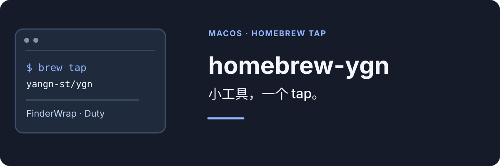

**[English](README.md) | 简体中文**

<p align="center">
  
</p>

YanGN 维护的个人 Homebrew tap，用来收纳 macOS 小工具。

tap 让 Homebrew 记录未进入主 cask 仓库的应用的版本、校验和与系统要求。每个 cask 下载项目发布的原始产物；tap 不会重新构建或签名。

## 软件

| 应用 | 用途 | 系统要求 |
|---|---|---|
| [FinderWrap](https://github.com/YanGN-ST/FinderWrap) | Finder 图标视图的左右键跨行导航 | macOS 13+，Apple Silicon |
| [Duty](https://github.com/YanGN-ST/Duty) | 监测并恢复选定的默认文件关联 | macOS 14+，Apple Silicon |

## 安装

```sh
brew tap yangn-st/ygn
brew install --cask yangn-st/ygn/finderwrap
```

确认 Homebrew 的提示前，请先核对 tap 和 cask 内容。使用 `brew upgrade --cask <名称>` 升级，使用 `brew uninstall --cask <名称>` 卸载。

## FinderWrap

FinderWrap 让 Finder 图标视图中的左右键跨行移动，并支持按住 Shift 把选择扩展到相邻行。画廊循环和列表视图导航在菜单栏面板中有独立开关。

- 需要授予辅助功能和输入监控权限，才能开启左右键跨行。
- 构建使用固定自签证书，未经过 Apple 公证。若 macOS 阻止首次打开，请核对下载来源，再到「系统设置 → 隐私与安全性」中允许打开。
- 仅支持 Apple Silicon 和 macOS 13 或更高版本。macOS 15 和 27 仍需实机验证。
- 如果应用看起来没有反应，可在菜单栏面板选择「复制诊断信息」；报告不包含文件名、路径或按键内容。

## Duty

Duty 把文件关联锁定到你选定的应用，并在被其他应用抢占时恢复。开启历史后，还会记录关联变化。

- 需要 macOS 14 或更高版本，以及 Apple Silicon。
- 应用未经过 Apple 公证。若 Gatekeeper 阻止首次打开，请核对来源并按系统提示处理，或运行 `xattr -cr /Applications/Duty.app`。
- 可选的 `duti` 组件用于识别系统无法解析的冷门扩展名；不安装也不影响 Duty 的核心功能。

## 维护

<details>
<summary>更新 cask</summary>

cask 文件位于 `Casks/`。FinderWrap 的发布包使用固定签名身份，需要手动更新 cask；Duty 指向其 GitHub Release 中的 DMG。

修改 cask 后运行：

```sh
brew style Casks/*.rb
brew audit --cask <name>
```

tap 不会在安装时构建或签名应用，只下载各项目已经发布的产物。

</details>

## 许可

本仓库见 [LICENSE](LICENSE)，各应用保留自己的许可。

[MIT](LICENSE) · [关注 YanGN 的小红书](https://www.xiaohongshu.com/user/profile/66a7e7ae000000001d023641)
